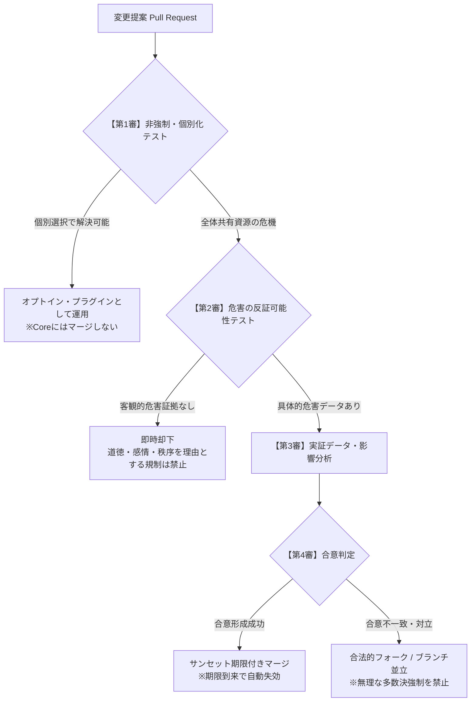

# 宇宙法マージプロトコル（Space Law Merge Protocol: SLMP-1）
**非領土型Git立法・合意調停プロトコル**

---

## 序論：なぜ白紙委任と国家司法独占を乗り越えるのか？

近代国家が採用してきた「全人格的な白紙委任選挙」と「国家独占司法」は、公平な統治システムではなく、**支配と責任転嫁のための制度的トラップ**になりがちである。

### 1. 選挙（白紙委任・多数決）の構造的欠陥
- **免責ロンダリング**: 「選挙で選ばれた議員が決めた」ことを口実に悪法や公金利権を正当化し、「文句があるなら投票しろ、嫌なら立候補しろ」と個人に責任を転嫁する。
- **争点の抱き合わせ（Bundling）**: 有権者は「外交、福祉、税制、教育」などの無数の個別争点を、特定の政治家や政党という「1つのパッケージ」としてしか選べない。
- **51%による49%の専制（多数派の横暴）**: 僅差の多数派が、少数派の財産・自由・身体を合法的に収奪する装置と化す。

※なお、投票や選挙自体を絶対悪として教条的に全否定するのではない。投票は「必要な場面で局所的に使える一つの意思決定ツール」にすぎず、問題は「一票ですべてを白紙委任させ、退出を許さない国家の独占構造」にある。

### 2. 国家独占司法の構造的弊害
- **裁判権の独占と遅延**: 結審まで数年を要し、巨額の費用を払える富裕層や巨大組織だけが有利になる。
- **民事と刑事の役割分担**: 契約や取引の紛争は当事者間の合意仲裁で迅速に解決できる。一方で、物理的暴力や重大犯罪の抑止は既存国家の警察・司法インフラ（互換レイヤー）に依存・併存している現実を直視し、宇宙政府が独自の刑務所や私刑制裁を捏造しない。

宇宙法は、**「分散型Gitプロトコル」「オプトイン・ブランチ並立」「フォーク権」**による実利的な立法・改訂プロセスを採用する。

---

## 宇宙法マージプロトコル（SLMP-1）の基本原則



---

### 第1原則：非強制・個別化の優先（Subsidiarity & Modular Opt-in）
1. **全体強制の禁止**:
   新しい規則やパラメータ変更を提起する者は、まず「なぜそれが個別共同体や個人ごとの選択（オプトイン規約）では解決できないのか」を証明しなければならない。
2. **プラグイン化**:
   特定の価値観、ライフスタイル、分配ルールに関する提案は、全市民に強制するCore法典へマージしてはならず、独立した「オプトイン・ブランチ（プラグイン）」として公開・運用されなければならない。

---

### 第2原則：危害の反証可能性テスト（Harm Falsification & Burden of Proof）
1. **挙証責任は提案者側にある**:
   Core法典において強制力・制限を伴う条文変更を提案する場合、提案者は**「第三者に対する具体的・直接的・回復不能な危害」**の客観的証拠を提示しなければならない。
2. **主観的理由の却下**:
   以下の理由に基づく変更提案（PR）は却下される：
   - 「道徳的に好ましくない」「伝統や慣習に反する」
   - 「抽象的な秩序・美観・公共の福祉を乱す」
   - 「本人の健康や幸福のためである（パターナリズム・お節介）」

---

### 第3原則：事実とデータによる客観的検証（Empirical Data & Impact Analysis）
1. **価値の宣言と手段の分離**:
   提案は「目的とする指標」と「手段」を明確に分離する。
2. **実証的データ検証**:
   変更案がもたらす便益、費用、副作用のデータを公開し、関係当事者が検証できる状態を担保する。

---

### 第4原則：多数決専制の回避と当事者による柔軟な合意（Consensus & Stakeholder Governance）
1. **頭数だけの多数決による強要の禁止**:
   単なる頭数による過半数（51%）によって49%に理不尽な義務を課すマージは行わない。
2. **当事者性に応じた実利的な合意形成**:
   合意形成を行う場合、対象となる規約の直接的な利害関係（当事者性）を重く扱う。投票は必要なときに道具として活用し、教条化しない。

---

### 第5原則：自己破壊型コミット（Self-Expiring Sunset Commits）
1. **全マージへの失効期日埋め込み**:
   Core法典にマージされるすべてのコミットには、有効期限（最長2〜5年）が付与される。
2. **更新の挙証責任**:
   期限到来時に法律を延長するためには、「法律が存在したことによって問題が実際に解決されたか」の事後検証データを公開し、再度承認を得なければならない。データがない場合、コミットは**自動的に失効（廃止）**される。

---

### 第6原則：フォークの絶対権とブランチ並立（Fork Over Merge）
1. **マージ不能時の平和的分岐**:
   提案に関して合意が形成できない場合、多数派が少数派を屈服させてマージを強行してはならない。双方は異なるブランチ（Branch）を維持し、市民や契約当事者は自らが信頼するブランチを指定して社会契約を結ぶ。
2. **流血のない体制間競争**:
   あるブランチの統治が優れていれば自然と市民と経済がそちらへ移行（Exit）し、腐敗したブランチは自然消滅する。国家のような「領土を奪い合う戦争」を、「コードベースのフォークと市民の移動」へ置換する。

---

## マージプロセスの技術的ワークフロー

```
[Issue提起] 
  │ 具体的危害のデータ、解決したい課題、目的指標を提示
  ▼
[PR作成 (Pull Request)]
  │ 条文差分、客観的根拠、検証指標、失効期日を記述
  ▼
[CI/CD 自動検証]
  │ ・危害原則適合チェック（主観的道徳・パターナリズムの検出）
  │ ・サンセット条項（有効期限）の構文チェック
  │ ・オプトイン分離可能性チェック
  ▼
[公開レビュー & 実証データの検証]
  │ 影響分析、利害関係者の合意形成
  ▼
[マージ判定]
  ├─ 十分な合意とデータ検証 ────► [サンセット付きマージ実行 (Core)]
  ├─ 部分的合意 ─────────────────► [プラグイン/オプトイン・モジュールとしてリリース]
  └─ 意見対立・分立 ─────────────► [ブランチ並立 / 平和的フォーク (Fork)]
```
