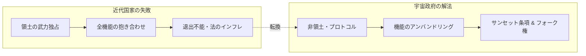

# 宇宙政府 最小限必要法典――法学・経済学・哲学から導く20の基本規範

## 一文で言うと

国家による「領土・暴力・法・通貨・心の帰属」の強制的な抱き合わせを解体し、ノージックの最小国家論、オストロムのコモンズ統治論、ハイエクの貨幣発行自由化論、カントの世界市民法を統合して策定された、宇宙時代における必要最小限のGitネイティブ法典。

---

## 1. なぜ「最小限の法律」なのか？

人類がこれまでに築いてきた近代国家の法制度は、常に「物理的領土（土地）の軍事的囲い込み」と「国民に対する全人格的な抱き合わせ（Bundling）」を前提としてきました。

- **住所**：生まれた場所や住む場所が、強制的に適用される法律と納税義務を決める。
- **正統性の錯覚**：警察や軍事力で「現実に従わせられる（実効支配）」ことをもって、その法律が「道徳的に正しい」「有効である」と強弁する。
- **立法のインフレ**：一度作られた法律や既得権益は決して廃止されず、官僚組織と公金利権カルテルの防壁として永久に増殖し続ける。

宇宙空間やデジタル空間において、従来の領土国家モデルをそのまま複製すれば、軌道スロットの奪い合い、宇宙資源の軍事的独占、そしてケスラー・シンドローム（軌道デブリによる宇宙空間の封鎖）による共倒れが待っています。

宇宙政府が目指すのは、「新しい巨大政府」を作ることではありません。
**「人間が互いに危害を及ぼさず、共有資源を枯渇させず、自発的に協調するために『絶対に削れない最小限のルール』とは何か？」**
これを法学、経済学、政治哲学の歴史的叡智から蒸留したものが、この「最小限必要法典（Minimal Space Law Code）」です。

---

## 2. 学術的・思想的バックボーン

本法典は、思いつきのユートピア主義ではなく、以下の確立された学術体系と歴史的知見に依拠しています。

### ① 政治哲学・正義論
- **ロバート・ノージック（『アナーキー・国家・ユートピア』）**：
  国家の正当な機能は、暴力・盗盗・詐欺からの保護と契約の執行（最小国家）に限られる。さらに、単一の理想社会を強制するのではなく、無数の実験的共同体が並立し個人が自由に選べる「メタ・ユートピアの枠組み」を採用（第1条〜第3条）。
- **イマヌエル・カント（『永遠平和のために』）**：
  世界市民法（*Weltbürgerrecht*）と普遍的歓待の権利。国家が領土を私有財産のように売り買い・支配することを禁じ、理性的存在の連合による平和秩序を構想（第1条、第2条、第16条）。
- **アルバート・ハーシュマン（『離脱・発言・忠誠』）**：
  国家が国民の「退出（Exit）」を封じるからこそ、制度は腐敗し、国民の「発言（Voice）」は無視される。無条件の退出権とデータ可搬性を保障することで、統治プロトコル間の健全な競争圧力を維持する（第5条、第20条）。
- **ジョン・スチュアート・ミル（『自由論』）**：
  文明社会において、個人の自由に対する強制が正当化される唯一の目的は「他者への危害の防止（Harm Principle）」である。自己加害や道徳的タブーを理由とする介入を徹底排除（第3条）。

### ② 経済学・インセンティブ設計・コモンズ論
- **エリノア・オストロム（ノーベル経済学賞 / コモンズの統治論）**：
  「国家による国有化」か「完全私有化」かという不毛な二者択一を超え、利用当事者自身による「多中心的ガバナンス（Polycentric Governance）」によって共有資源（コモンズ）が持続可能に管理できることを実証。軌道スロット・電波・月面氷資源の管理に適用（第6条、第7条）。
- **アーサー・C・ピグー ＆ ロナルド・コース**：
  外部不経済（軌道デブリ、電波干渉、環境汚染）を「ケスラー債（デブリ預託返還金）」やピグー的課金によって内部化。取引費用を最小化するスマートコントラクトを実装（第8条、第12条）。
- **F.A.ハイエク（『貨幣発行自由化論』）**：
  国家による通貨発行独占と中央銀行のインフレ増税（シニョリッジ）を解体し、民間・コミュニティ通貨の自由競争を導入。宇宙政府のネイティブ単位「UNI」と初期基本給 $10^6\text{ UNI}$ の無条件交付（第10条）。

### ③ 法学・国際法・宇宙法
- **1967年宇宙条約 ＆ 国連海洋法条約（UNCLOS）**：
  天体の非領有原則（Non-Appropriation）、全人類の領分（Province of all mankind）、公海自由の原則をベースとしつつ、国家主権の枠組みを分散型プロトコルへ昇華（第2条、第6条）。
- **中世商人法（*Lex Mercatoria*）と法多元主義**：
  国境を越えた商人が自律的に形成した仲裁裁判所と信認ネットワークのように、合意管轄と分散型オラクル裁判（Kleros型）による迅速・適正な司法（第14条、第15条）。
- **罪刑法定主義と修復的正義（Restorative Justice）**：
  加虐的・復讐的な刑罰や監獄ビジネスを廃止し、被害者への実効的な損害賠償・原状回復（Restitution）を最優先とする（第15条）。

---

## 3. 宇宙政府 最小法典（全20条の体系）

### 【第0編：根本規範と基本的人権】
国家の専制と暴力から個人を切り離す絶対防壁。

- **第1条（帰属選択の自由と多重所属）**：生まれた国や住所への忠誠義務を否定。心の国籍は自己選択。
- **第2条（非領土性と管轄の非独占）**：土地の領有権・武力境界を主張しない。法は合意に基づき及ぶ。
- **第3条（危害原則と最小強制）**：他者への具体的危害の防止以外に、いかなる強制も発動できない。
- **第4条（生命・意識・身体の不可侵権）**：死刑・拷問・洗脳の絶対禁止。生命維持の遮断は殺人未遂。
- **第5条（無条件退出権とデータ可搬性）**：いつでもワンクリックで全データを持って完全EXIT可能。

### 【第1編：宇宙コモンズ・軌道環境・資源法】
宇宙空間の「コモンズの悲劇」を回避し、持続可能なフロンティアを維持。

- **第6条（天体・軌道・周波数の非領有と共同利用）**：月・火星・LEO軌道・電波は全生命の共有財。
- **第7条（資源採取権とオストロム型多中心管理）**：資源の採取・利用権（用益権）は認めるが土地所有は否定。当事者自治で過剰採取を防止。
- **第8条（軌道デブリ責任とケスラー債）**：打上げ時にデブリ回収保証金を預託。自己除去で全額返還、放置でADR事業者へ懸賞金。
- **第9条（惑星保護と未知生命系保全）**：前方・後方汚染の防止。未知生命の発見区域は科学的聖域へ。

### 【第2編：経済自律・通貨・契約法】
国家の収奪から逃れ、自由でオープンな経済循環を創出。

- **第10条（通貨競合と初期基本給）**：法定通貨の強制を拒絶。全宇宙国民に $10^6\text{ UNI}$ を無条件交付。
- **第11条（契約自由とスマート仲裁プロトコル）**：コードによるスマートコントラクトと分散仲裁の承認。
- **第12条（外部性の内部化と非搾取的公共財調達）**：強制徴税を廃止。ピグー利用料とクアドラティック・ファンディング（QF）で公金を調達。
- **第13条（基盤独占の禁止と相互運用性の義務）**：生命維持・通信・ハッチ結合規格の開放と相互運用性。

### 【第3編：紛争解決・司法・修復的正義】
国家独占の遅延・高コスト裁判を解体し、公正な救済を実現。

- **第14条（合意管轄と分散型裁判所）**：当事者が選ぶ仲裁人と透明な評価。
- **第15条（適正手続・比例原則・修復的正義）**：刑罰ではなく被害者への原状回復・賠償を第一義とする。
- **第16条（宇宙救難義務と普遍的相互扶助）**：極限環境での遭難救助の義務化と救助費用の優先補償。

### 【第4編：自律エージェント・知能・生命体法】
人間中心主義を超え、AIエージェントや合成知性と共存する法秩序。

- **第17条（自律AIエージェントの代理権と責任連鎖）**：AIのDID・ウォレット保有と損害賠償責任の連鎖順位。
- **第18条（合成意識および非人類知性の尊厳保護）**：主観的苦痛を持つ高度知性に対する電子的虐待の禁止。

### 【第5編：Gitネイティブ立法・検証・フォーク】
法を永久の権威から「使い捨て可能なプロトコル」へ。

- **第19条（義務的サンセット条項と実証的検証）**：全条文に失効期限を義務付け。データによる検証なしの延長を禁止。
- **第20条（Git改訂手続と合法的分岐権）**：すべての法をGitHub等で管理。意見が合わなければ流血なしに法典をフォーク（分岐）して独立する権利を保障。

---

## 4. 既存の宇宙法（Outer Space Treaty / Artemis Accords）との違い

| 項目 | 1967年 国連宇宙条約 | アルテミス合意 (NASA系) | 宇宙政府 最小法典 (UNIVGOV) |
|---|---|---|---|
| **主体の前提** | 主権国家（States） | 国家＋米系メガ宇宙企業 | 個人・分散型共同体・AIエージェント |
| **領有・管轄** | 国家による領有禁止 | 安全地帯（Safety Zones）による実質囲い込み | **非領土・合意管轄（スマートコントラクト）** |
| **資源採取** | 規定が曖昧（解釈論争中） | 先占による私的所有権を容認 | **労働用益権（Usufruct）＋オストロム型共有管理** |
| **環境・デブリ** | 国家間協議のみ（実効性薄） | ガイドライン準拠 | **ケスラー債（預託返還金）による経済的内部化** |
| **法と統治の改訂** | 全会一致が必要（改訂不能） | 米国のリーダーシップ | **Gitネイティブ・サンセット条項・フォーク権** |

---

## 5. 結論：法を神棚から降ろし、Gitへ

法律とは、神が授けたものでも、偉い政治家が国民を支配するための道具でもありません。
それは、**「人間が互いに傷つけ合わずに共同生活を営むための、オープンソースのライブラリ」**にすぎません。

バグがあればPR（プルリクエスト）を送り、時代遅れになればサンセット条項で破棄し、どうしても運営方針が合わなければ平和的にフォークする。

この最小法典は、人類が国家という「運命の檻」から抜け出し、宇宙という無限のフロンティアで真の自由と自治を獲得するための、最初のオープンな土台です。
