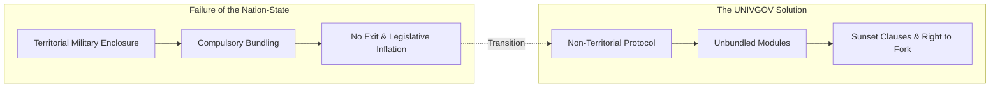

# Minimal Space Law Code: 15 Core Norms Derived from Jurisprudence, Economics, and Philosophy

## In One Sentence

A Git-native, minimal legal framework for the space age that deconstructs the state's bundled coercion over territory, law, currency, and allegiance by integrating Robert Nozick's minimal state, Elinor Ostrom's commons governance, F.A. Hayek's monetary freedom, and Immanuel Kant's cosmopolitan law.

---

## 1. Why "Avoid Writing Unnecessary Rules"?

The legal systems of modern nation-states were built on two foundational premises: the military enclosure of physical territory and the compulsory bundling of citizen life.

- **Residence as Fate**: Where you are born or reside dictates the laws you must obey and the taxes you must pay.
- **The Illusion of Legitimacy**: The physical ability to enforce obedience through police and military force is falsely equated with moral legitimacy and policy efficacy.
- **Legislative Inflation**: Laws once enacted are almost never repealed; they proliferate indefinitely to protect bureaucratic cartels and rent-seeking interests.

The goal of UNIVGOV is not to build another mega-state, nor to write endless lists of commands.
Rather, it is a defensive protocol: **"What is the absolute minimum framework necessary to prevent the governing apparatus from expanding coercion and manufacturing unnecessary rules?"**

---

## 2. Theoretical & Philosophical Foundations

This code is grounded in centuries of established jurisprudence, economics, and political philosophy:

### ① Political Philosophy & Jurisprudence
- **Robert Nozick (*Anarchy, State, and Utopia*)**:
  The legitimate function of governance is strictly limited to protection against force, theft, fraud, and the enforcement of contracts (the minimal state). Adopts the "framework for utopia" where diverse experimental communities coexist and individuals choose freely (Articles 1–3).
- **Immanuel Kant (*Perpetual Peace*)**:
  Cosmopolitan law (*Weltbürgerrecht*) and universal hospitality. Rejects the treatment of land and states as personal property to be conquered or bought (Articles 1, 2, 13).
- **Albert O. Hirschman (*Exit, Voice, and Loyalty*)**:
  When states block the "Exit" route, institutions rot and citizen "Voice" is ignored. Guaranteeing absolute exit rights and data portability maintains healthy competitive discipline on governance (Articles 5, 15).
- **John Stuart Mill (*On Liberty*)**:
  The only purpose for which power can be rightfully exercised over any member of a community against their will is to prevent harm to others (The Harm Principle) (Article 3).

### ② Economics & Commons Governance
- **Elinor Ostrom (*Governing the Commons*)**:
  Transcending the false dichotomy between state nationalization and total privatization through polycentric governance by stakeholders themselves. Applied to orbital slots, spectrum, and lunar ice (Articles 6, 7).
- **Arthur C. Pigou & Ronald Coase**:
  Internalizing negative externalities via Pigovian pricing and voluntary public goods funding (Article 11).
- **F.A. Hayek (*The Denationalisation of Money*)**:
  Abolishing central bank monopolies and inflationary seigniorage through free currency competition. UNIVGOV implements native token "UNI" and unconditional 1,000,000 UNI initial grant for bootstrap liquidity (Article 9).

### ③ Interoperability & Pluralistic Justice
- **1967 Outer Space Treaty & UNCLOS**:
  Non-appropriation principle, province of all mankind, and freedom of the commons transformed into decentralized open protocols (Articles 2, 6).
- **Medieval *Lex Mercatoria* & State Interoperability**:
  Civil and contractual disputes are resolved through consensual decentralized arbitration. Physical violence deterrence and criminal justice realistically rely on existing state infrastructure (the interoperability layer), rather than inventing artificial prisons or vigilante sanctions (Article 12).

---

## 3. The Minimal Space Law Code (15 Core Articles)

### Part 0: Charter & Fundamental Inviolabilities
- **Art 1 (Freedom of Allegiance & Plurality)**: Mental allegiance is separated from birth/address. Plural membership is guaranteed.
- **Art 2 (Non-Territoriality & Non-Monopoly)**: No claims of sovereignty over land/space. Jurisdiction is strictly consent-based.
- **Art 3 (Harm Principle & Minimal Coercion)**: Coercion is strictly limited to preventing concrete, identifiable harm to others. Anti-paternalism.
- **Art 4 (Inviolability of Life, Mind & Body)**: Absolute ban on death penalty, torture, and forced mind control. Disconnecting life support is attempted murder.
- **Art 5 (Right of Exit & Data Portability)**: Unconditional 1-click exit and complete off-chain personal data erasure or standard export.

### Part 1: Space Commons & Open Infrastructure
- **Art 6 (Celestial & Orbital Commons)**: Celestial bodies, orbits, and radio spectrum belong to no single entity.
- **Art 7 (Resource Usufruct & Polycentric Governance)**: Usufructuary rights for extracted resources without land ownership; Ostrom-style management.
- **Art 8 (Anti-Monopoly of Core Infrastructure)**: Mandatory open standards and interoperability for life-support, docking, and communication.

### Part 2: Economic Autonomy & Currency Freedom
- **Art 9 (Monetary Freedom & Native Grant)**: No legal tender laws. Unconditional 1,000,000 UNI bootstrap grant with pragmatic Web2/Google auth onboarding in early phases.
- **Art 10 (Contractual Autonomy & Smart Arbitration)**: Recognition of smart contracts with pre-designated dispute relief mechanisms. Exploitative contracts targeting non-competent minors or violating bodily inviolability (Art 4) are null and void ab initio.
- **Art 11 (Non-Coercive Public Goods Funding)**: No punitive taxes. Funding via Pigovian usage fees and voluntary Quadratic Funding.

### Part 3: Dispute Resolution & Interoperability
- **Art 12 (Consensual Arbitration & State Interoperability)**: Consensual private arbitration for civil contracts. Physical violence is handled via existing state legal frameworks.
- **Art 13 (Universal Duty of Rescue)**: Mandatory mutual aid in life-threatening space emergencies with prioritized salvage compensation.

### Part 4: Git-Native Legislation & Forking
- **Art 14 (Mandatory Sunset Clauses)**: Automatic expiration of laws without empirical evidence of problem-solving.
- **Art 15 (Git Revision & Inherent Right to Fork)**: Voting treated as a pragmatic tool. Refusing tyranny of majority; guaranteed right to peacefully fork code and protocols without retaliation.

---

## 4. Comparison with Existing Space Treaties

| Feature | 1967 Outer Space Treaty | Artemis Accords (US-led) | UNIVGOV Minimal Law Code |
|---|---|---|---|
| **Primary Actor** | Sovereign States | States + US Aerospace Megacorps | Individuals, DAOs, Communities |
| **Territory & Jurisdiction** | National non-appropriation | "Safety Zones" (De facto enclosure) | **Non-territorial, Smart Contract consent** |
| **Resource Extraction** | Ambiguous | First-claimant property rights | **Labor Usufruct + Ostrom Commons** |
| **Violence & Justice** | State jurisdiction | State jurisdiction | **Civil arbitration + State Interoperability Layer** |
| **Amendment & Governance** | Consensus gridlock (Unchangeable) | US-led bilateral pacts | **Git-Native, Sunset, Inherent Right to Fork** |

---

## 5. Conclusion: Bringing Law from the Altar to Git

Law is neither a sacred command from heaven nor a weapon for rulers to dominate populations.
It is simply **"an open-source library for human beings to coordinate without harming one another."**

If there is a bug, submit a Pull Request. If a rule becomes obsolete, let it expire via sunset clauses. If fundamental visions diverge, fork peacefully without bloodshed.
Refusing to burden human beings with unnecessary rules is the ultimate mission of this code.
