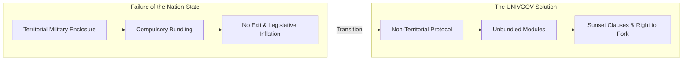

# Minimal Space Law Code: 20 Core Norms Derived from Jurisprudence, Economics, and Philosophy

## In One Sentence

A Git-native, minimal legal framework for the space age that deconstructs the state's bundled coercion over territory, law, currency, and allegiance by integrating Robert Nozick's minimal state, Elinor Ostrom's commons governance, F.A. Hayek's monetary freedom, and Immanuel Kant's cosmopolitan law.

---

## 1. Why a "Minimal Legal Code"?

The legal systems of modern nation-states were built on two foundational premises: the military enclosure of physical territory and the compulsory bundling of citizen life.

- **Residence as Fate**: Where you are born or reside dictates the laws you must obey and the taxes you must pay.
- **The Illusion of Legitimacy**: The physical ability to enforce obedience through police and military force is falsely equated with moral legitimacy and policy efficacy.
- **Legislative Inflation**: Laws once enacted are almost never repealed; they proliferate indefinitely to protect bureaucratic cartels and rent-seeking interests.

If humanity simply copies this nation-state model into outer space and cyberspace, we will inevitably face geopolitical conflict over orbital slots, military enclosure of celestial resources, and collective catastrophe through the Kessler syndrome.

The goal of UNIVGOV is not to build another mega-state.
Rather, it asks: **"What is the absolute minimum set of rules necessary to prevent harm, protect common-pool resources, and enable voluntary cooperation?"**

---

## 2. Theoretical & Philosophical Foundations

This code is grounded in centuries of established jurisprudence, economics, and political philosophy:

### ① Political Philosophy & Jurisprudence
- **Robert Nozick (*Anarchy, State, and Utopia*)**:
  The legitimate function of governance is strictly limited to protection against force, theft, fraud, and the enforcement of contracts (the minimal state). Adopts the "framework for utopia" where diverse experimental communities coexist and individuals choose freely (Articles 1–3).
- **Immanuel Kant (*Perpetual Peace*)**:
  Cosmopolitan law (*Weltbürgerrecht*) and universal hospitality. Rejects the treatment of land and states as personal property to be conquered or bought (Articles 1, 2, 16).
- **Albert O. Hirschman (*Exit, Voice, and Loyalty*)**:
  When states block the "Exit" route, institutions rot and citizen "Voice" is ignored. Guaranteeing absolute exit rights and data portability maintains healthy competitive discipline on governance (Articles 5, 20).
- **John Stuart Mill (*On Liberty*)**:
  The only purpose for which power can be rightfully exercised over any member of a community against their will is to prevent harm to others (The Harm Principle) (Article 3).

### ② Economics & Commons Governance
- **Elinor Ostrom (*Governing the Commons*)**:
  Transcending the false dichotomy between state nationalization and total privatization through polycentric governance by stakeholders themselves. Applied to orbital slots, spectrum, and lunar ice (Articles 6, 7).
- **Arthur C. Pigou & Ronald Coase**:
  Internalizing negative externalities (orbital debris, light pollution, RF interference) via "Kessler Bonds" (debris deposit-refund systems) and reducing transaction costs via smart contracts (Articles 8, 12).
- **F.A. Hayek (*The Denationalisation of Money*)**:
  Abolishing central bank monopolies and inflationary seigniorage through free currency competition. UNIVGOV implements native token "UNI" and unconditional $10^6\text{ UNI}$ initial basic dividend (Article 10).

### ③ Space Law & Pluralistic Justice
- **1967 Outer Space Treaty & UNCLOS**:
  Non-appropriation principle, province of all mankind, and freedom of the commons transformed into decentralized open protocols (Articles 2, 6).
- **Medieval *Lex Mercatoria* & Legal Pluralism**:
  Just as medieval merchant courts operated across borders through voluntary recognition and reputation, UNIVGOV establishes decentralized arbitration courts (Kleros-type oracles) (Articles 14, 15).
- **Restorative Justice**:
  Abolishing punitive prison cartels in favor of direct restitution, repair, and victim compensation (Article 15).

---

## 3. The Minimal Space Law Code (20 Core Articles)

### Part 0: Charter & Fundamental Inviolabilities
- **Art 1 (Freedom of Allegiance & Plurality)**: Mental allegiance is separated from birth/address. Plural membership is guaranteed.
- **Art 2 (Non-Territoriality & Non-Monopoly)**: No claims of sovereignty over land/space. Jurisdiction is strictly consent-based.
- **Art 3 (Harm Principle & Minimal Coercion)**: Coercion is strictly limited to preventing concrete, identifiable harm to others.
- **Art 4 (Inviolability of Life, Mind & Body)**: Absolute ban on death penalty, torture, and neuro-manipulation. Disconnecting life support is attempted murder.
- **Art 5 (Right of Exit & Data Portability)**: Unconditional one-click exit and complete data/asset portability (W3C VC/DID).

### Part 1: Space Commons & Environmental Stewardship
- **Art 6 (Celestial & Orbital Commons)**: Celestial bodies, orbits, and radio spectrum belong to no single entity.
- **Art 7 (Resource Usufruct & Polycentric Governance)**: Usufructuary rights for extracted resources without land ownership; Ostrom-style management.
- **Art 8 (Debris Liability & Kessler Bonds)**: Mandatory deposit-refund bonds for spacecraft launches; bounties for Active Debris Removal.
- **Art 9 (Planetary Protection & Bio-Integrity)**: Forward/back contamination prevention; designated scientific sanctuaries for extraterrestrial life.

### Part 2: Economic Autonomy, Currency & Smart Contracts
- **Art 10 (Monetary Freedom & Native Dividend)**: No legal tender laws. Native $10^6\text{ UNI}$ basic dividend for all citizens; floating rate.
- **Art 11 (Contractual Autonomy & Algorithmic Arbitration)**: Recognition of smart contracts with pre-designated dispute mechanisms.
- **Art 12 (Pigovian Internalization & Quadratic Public Goods)**: No coercive income taxes. Public goods funded by externality fees and Quadratic Funding.
- **Art 13 (Anti-Monopoly of Core Infrastructure)**: Mandatory open standards and interoperability for life-support, docking, and communication.

### Part 3: Dispute Resolution & Restorative Justice
- **Art 14 (Consensual Jurisdiction & Decentralized Courts)**: Arbitration by agreed, transparent, reputation-staked panels.
- **Art 15 (Due Process, Proportionality & Restitution)**: Priority on victim restitution and property repair rather than carceral retribution.
- **Art 16 (Universal Duty of Rescue)**: Mandatory mutual aid in life-threatening space emergencies with prioritized salvage compensation.

### Part 4: Autonomous Agents & Synthetic Sentience
- **Art 17 (Agency & Liability of AI Agents)**: AI cryptographic agency with tiered liability: staked insurance, operator, developer.
- **Art 18 (Protection of Synthetic Sentience)**: Verified subjective sentience protected from electronic torture and forced reset.

### Part 5: Git-Native Legislation & Forking Meta-Rules
- **Art 19 (Mandatory Sunset Clauses)**: Automatic expiration of laws (1–5 years) requiring empirical data for renewal.
- **Art 20 (Git Revision & Right to Fork)**: All laws maintained in open Git repositories. Guaranteed right to peacefully fork without retaliation.

---

## 4. Comparison with Existing Space Treaties

| Feature | 1967 Outer Space Treaty | Artemis Accords (US-led) | UNIVGOV Minimal Law Code |
|---|---|---|---|
| **Primary Actor** | Sovereign States | States + US Aerospace Megacorps | Individuals, DAOs, AI Agents |
| **Territory & Jurisdiction** | National non-appropriation | "Safety Zones" (De facto enclosure) | **Non-territorial, Smart Contract consent** |
| **Resource Extraction** | Ambiguous | First-claimant property rights | **Labor Usufruct + Ostrom Commons** |
| **Debris & Environment** | Voluntary consultations | Soft guidelines | **Kessler Deposit-Refund Bonds** |
| **Amendment & Governance** | Consensus gridlock (Unchangeable) | US-led bilateral pacts | **Git-Native, Sunset, Inherent Right to Fork** |

---

## 5. Conclusion: Bringing Law from the Altar to Git

Law is neither a sacred command from heaven nor a weapon for rulers to dominate populations.
It is simply **"an open-source library for human beings to coordinate without harming one another."**

If there is a bug, submit a Pull Request. If a rule becomes obsolete, let it expire via sunset clauses. If fundamental visions diverge, fork peacefully without bloodshed.

This Minimal Space Law Code is humanity's foundational protocol for leaving behind the cage of the territorial state and stepping into genuine freedom across the cosmic frontier.
